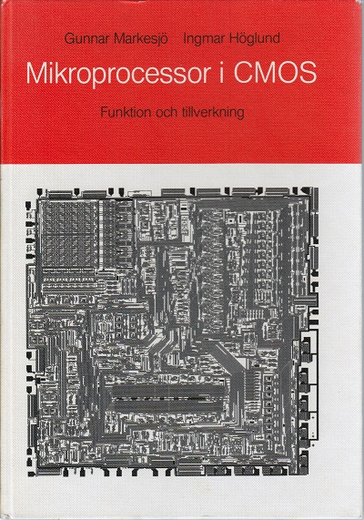
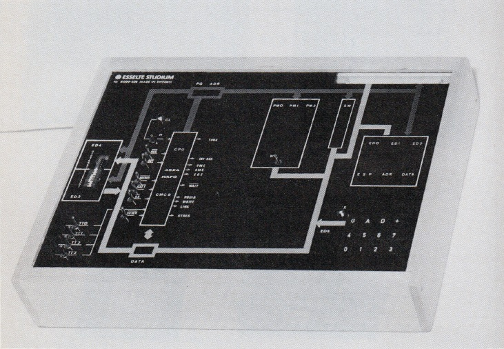
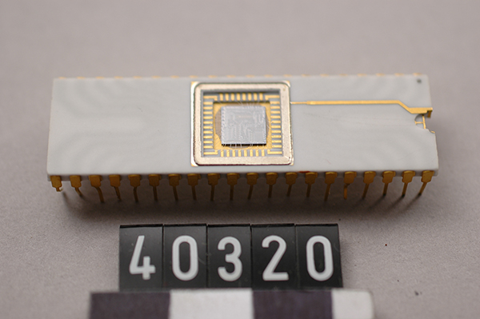

# ASEA-HAFO CMC8 analysis

The book _Mikroprocessor i CMOS_ by Gunnar Markesjö and Ingmar Höglund (ISBN 91-24-27562-X)
describes in great detail the inner workings of the only (as far as I know) Swedish-made
microprocessor, the CMC8 by ASEA-HAFO. The book was published in 1978 so the processor must
have been developed around that time.



This repository contains the result of a deep analysis of the processor based on the information
in the book. The aim has been to extrapolate all instruction signaling and timing in order to
build a complete reimplementation, in emulated form as well as using an FPGA.

The book also describes Midahs, a demonstration computer based on the CMC8. A secondary aim is
to reconstruct this system as far as possible.



## The processor

[](https://digitaltmuseum.se/021026356822/integrerad-krets-till-dator)

CMC8 is a CMOS processor, in a 40-pin DIL package. It has a 8-bit address bus plus two Page pins,
and an 8-bit data bus. It was thought of as a "microcontroller" at the time, in the sense that
it was meant be used as a programmable logic component.

It has 43 instructions according to the book.

## The investigation

I started looking at this around six years ago, but it stalled due to other priorities and the
incredible amount of work it would take to figure out all the timings, fill in the gaps left
by the book, and produce test harnesses to verify everything.

This is where AI can do wonders, as long as you stay in control. I've been using Codex CLI
to look through the scanned pages of the book, extract all the provided signaling diagrams
and evaluate them, and from that extrapolate one set of instructions at a time, carefully
recording what's known, what's assumed based on good evidence or a principle of simplicity
and consistency in the design, and what's merely a guess.

Alternatives have been recorded in cases where we couldn't be sure, and an errata document
has been produced for the book, as inconsistencies and impossibilities have been identified.

I expected numerous stumbling blocks, but in the end, only a single hardware component had
to be invented in order to implement a slightly tricky instruction, and it's not a
controversial feature. Almost all the signaling and the assumptions made to fill gaps were
soundly based in information provided in the book.

Even though what we (yeah, I'm going to keep saying "we" - I'm not antropomorphizing a
glorified text generator, I'm just using language in a rational way) have produced is
almost certainly not an exact replica of the original CMC8 design, I am confident that it
it good enough to base a reimplementation off.

Hopefully, by the time you read this, and even if I forget to update this document, you
will find some sort of emulator in this repo, and hopefully also a macro assembler for
the CMC8. And all of the design and decision documents should be here too, in case you want
to follow the investigation.

## Standalone macro assembler

[cmc8asm](assembler/README.md) is a portable C99 application with macros,
includes, expressions, page-aware labels, listings and symbol maps. It emits
Intel HEX or a flat 1,024-byte binary image and needs no Python runtime.

```sh
cmake -S assembler -B assembler/build
cmake --build assembler/build
./assembler/build/cmc8asm examples/traffic.asm -o /tmp/traffic.hex
```

The traffic source reproduces all 75 book bytes. All 239 encodings, explicit
page wrapping and a cross-page call trampoline are checked independently;
the current complete project suite has 363 passing tests. The assembler
directory has also been built and run separately from this repository.

## Browser traffic lights

The [traffic demo](demos/traffic/README.md) runs the original machine code in a
lightweight instruction-level JavaScript core. Cars activate the demand sensors;
the CMC8 program controls the signals. It includes pause/speed controls and
Intel HEX loading, and runs entirely in the browser without dependencies.

```sh
python3 -m http.server 8000
```

Open <http://localhost:8000/demos/traffic/>. The demo core currently supports
the traffic program's instruction families; the numbered research models
remain the reference for signaling and the complete processor.


## Development and local research inputs

Run the test suite with `python3 -m unittest discover -s tests`. The assembler
checks require CMake and a C99 compiler; browser-core checks require Node.js.
Those checks are skipped when their build/runtime tools are unavailable.

The full book PDF, page scans in `bookpages/`, and the full-book OCR cache
`specification/ocr-pages.json` are local research inputs excluded from Git.
References to those scans will only open when you provide your own local copy.
The three smaller README illustrations are included. The committed catalogue,
source transcriptions, focused OCR search snippets, and generated references
allow normal development and tests without the full book files.

`python3 -m tools.build_instruction_reference --check` checks generated
references. Without the local OCR cache, it reuses the committed search
snippets. To refresh the OCR search from the PDF, install `pdftotext`, run
`python3 -m tools.index_book`, then regenerate the references. To check the
presence of every catalogued page scan as well, use
`python3 -m tools.build_instruction_reference --check --check-scans`.
