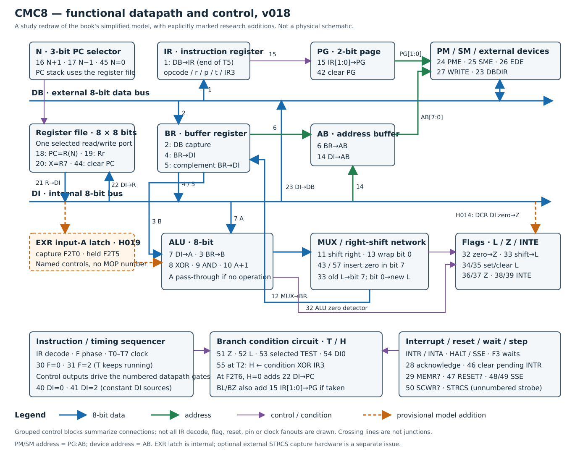

# CMC8 learning reference

Start with the [instruction card](instructions.md), keep the [MOP list](mops.md) beside the
[phase tables](timing.md), and use the [internal-structure SVG](processor.svg) to follow each transfer.

This is a learning view of the **v018 research model**, based on the CMC8 material in the book.
The diagram is a functional redraw, not a die layout or a wiring/netlist claim. Blue paths carry
8-bit data; green paths carry addresses; purple paths carry selection/condition/control signals.
Dashed orange elements mark the added EXR holding latch and the provisional DCR zero-input path.
The numbered functions remain those in the book; named extra controls have no invented MOP number.

The register file has one selected port: PC means R(N), Rr means R(IR[2:0]), X means R7.
These can alias. PG supplies the high two memory-address bits, AB the low eight; ED ports use AB only.
N wraps modulo eight; register values and address offsets wrap modulo 256.

Only the source-linked notes distinguish printed timing, accepted corrections, and extrapolated
schedules in detail. Each instruction table links to its existing evidence record. In particular,
EXR's latch (H019), DCR's zero source (H014), inferred indexed transfers, and shared wait/single-step
controls remain working choices. Successful simulation is evidence of consistency, not silicon proof.
Other architectures illustrated by the book are not incorporated here.

These Markdown files are generated by `python3 tools/build_learning_reference.py`;
`--check` checks reproducibility. The SVG is separately authored for readability.
The original [full catalogue](../instruction-set.md), [book errata](../errata.md), and
[v018 execution-control notes](../model-v018.md) remain the detailed references.
