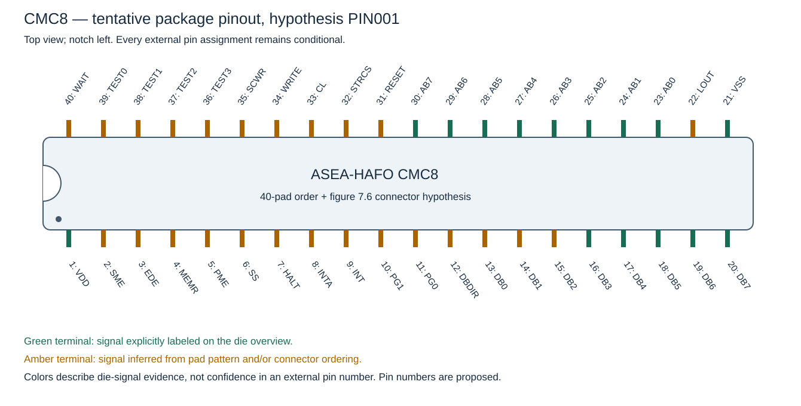

# CMC8 package pinout investigation — PIN001

**A strong, internally consistent candidate, not a verified package pinout.**
The die-pad sequence, the owner's orientation correlation and the Midahs
connector together suggest a complete 40-pin assignment. No simulator
architecture change is involved.



All numbers in the drawing and table are proposed **external package pin
numbers**, using the standard top-view DIP convention with the notch left:
lower row 1→20 left-to-right; upper row 40→21 left-to-right. Green means the
signal is explicitly labeled on the die, not that its external number has
been confirmed. The drawing is a schematic, not an annotated photograph.

## Observations and sources

- The supplied [colour package photo](../TEKS0043130.jpg) and
  [black-and-white photo](<../TEKS0043130 (1).jpg>) show the opened package.
  The colour view has the notch on the right; the black-and-white view has
  it on the left. The apparent pin-one dot agrees with those orientations.
  Fine bonds are visible, but the carrier's entire route to each external
  lead cannot be followed through the ceramic.
- The [cover](../bookpages/Front.jpg) and
  [figure 3.5, p.35](../bookpages/Page_041.jpg) have the register bank at
  upper left, ALU/BR/AB at upper right and instruction decoder below.
  The owner's correlation places the notched short package end to the left
  in this die orientation. That correlation is a stated premise; the blurry
  package photo does not independently resolve every block or bond.
- [Figure 3.4, p.34](../bookpages/Page_040.jpg) supplies another die/bond
  photograph. It is useful for recognizing the layout and peripheral bonding,
  but does not show the whole DIP with numbered external leads.
- Figure 3.5 explicitly labels 15 pads: AB7…AB0, VSS, DB7…DB3 and VDD.
  The other three data pads at the lower-right edge have the same repeating
  driver pattern as the labeled data pads. Their continuation as DB2, DB1,
  DB0 is a strong structural inference, rather than a printed label.
- [Figure 7.6, p.114](../bookpages/Page_120.jpg) describes a **64-contact
  Midahs connector**, not a 40-pin CPU package. Its two columns are a/b,
  with 32 rows. The CPU-numbering relationship is an inference to test.

The unchanged source images remain authoritative. The
[authored pad inventory](../specification/pinout-hypothesis.json) records
approximate pad centers in the full p.35 scan, the source label when present,
the proposed signal and the basis for assigning it. P00…P39 are research
pad IDs, increasing clockwise from the upper-left corner; they are not
package pin numbers.

## The unusually good connector match

The inventory has 40 perimeter pads. Reading around the right and lower-right
edges gives:

```text
AB7 AB6 AB5 AB4 AB3 AB2 AB1 AB0 [unlabeled] VSS DB7 DB6 DB5 DB4 DB3
                                                             DB2 DB1 DB0
```

The final three data labels are inferred from their repeating driver cells.
In the opposite direction this becomes:

```text
DB0 DB1 DB2 DB3 DB4 DB5 DB6 DB7 VSS [unlabeled] AB0 AB1 AB2 AB3 AB4 AB5 AB6 AB7
```

That matches connector **a13…a30**, including LINK at a22 in the unlabeled
position between VSS and AB0. It makes that pad a plausible **LOUT** candidate.
The correspondence is more specific than simply putting each bus together.

The owner's additional count is particularly useful: **exactly eleven pads
lie between VDD and the DB0 candidate**. Thus VDD=1 gives DB0=13. Seven more
data pads then put VSS at 21. Independently counting the two explicitly
labeled supply pads around the inventory puts them twenty positions apart,
matching a1=+5 V and a21=0 V. These are relative layout checks; the absolute
numbers still come from the proposed connector/package correspondence.

Under a one-to-one, cyclic order-preserving mapping, assuming connector
rows a1…a31 reflect chip numbers yields **15/15 matches to the explicitly
labeled die pads**. Enumerating both directions and all 40 offsets gives
one such fit; the next-best cyclic fit matches only 2/15. This score checks
the consistency of that assumption with the observations. It is not a
statistical probability or evidence that the assumption must hold.

The proposed conversion from clockwise research index `i` to package pin is:

```text
pin = 1 + ((33 - i) modulo 40)
```

No known die label contradicts it. It also places all eleven intermediate
pads before DB0 where the connector's SME/EDE/MEMR/PME/SS/HALT/INTA/INT/
PG1/PG0/DBDIR sequence predicts them. Their individual identities have not
been traced electrically; agreement of their count does not prove their order.

## Additional package-bond anchor supplied by the owner

The owner traced the **seventh wire from the bottom on the right-hand die
edge** in the colour package photograph, also described as the third wire
in its clearly separated upper-half group, to the **sixth carrier finger
from the top**. The corresponding figure-3.5 die pad is VDD.

With the colour photograph's notch right, conventional pin 1 is the
upper-right external lead. Splitting a symmetric carrier into its upper
and lower 20-pin banks places this landing at the start of the first bank,
supporting **VDD=1 independently of the Midahs connector sequence**.
This is a more physical anchor than assigning VDD=1 from connector a1 alone.

The enlarged right-side crop is consistent with a wire landing in that
mid-side region, but fine endpoints and the hidden path to the external
lead are not all independently resolved. The wire/finger count is recorded
as an owner observation. Counting a corner finger as well as the straight
side fingers matters when comparing “sixth from the top” with an inventory.
The remaining premise is the symmetric bank split and carrier routing;
this has not become an electrically verified supply-pin assignment.

### Second supply anchor: VSS and the adjacent pad pairs

The owner traced the **sixth left-side carrier finger from the bottom**
in the notch-right colour photograph to the upper pad of a closely spaced
pair. After a short gap, another close pair follows. Under the same carrier
split, that finger is **pin21**.

Rotating figure3.5 by 180 degrees to match this photograph gives precisely
the observed local order: **VSS, its close neighbor (candidate LOUT), a gap,
then AB0/AB1 as another close pair**. Thus the match uses distinctive pad
spacing as well as the supply label. The enlarged crop shows the relevant
region, although all fine wire endpoints remain less clear than the owner's
trace. This is a second bond-based supply anchor, separate from assigning
connector a21 to chip pin21.

The two supply observations now support VDD1 and VSS21 from opposite sides
of the carrier. That substantially strengthens the proposed alignment while
retaining the die-orientation and carrier-routing assumptions.

### Apparent damage at proposed pin20

The owner also identified what appears to be a disconnected bond at the
neighboring proposed pin20, **DB7** in PIN001. The enlarged left-side crop
shows a conspicuous loose-looking curved wire in this region. Record this
as an apparent detached/displaced bond, not a measured open circuit.
If it is detached, it would leave DB7 disconnected under the candidate map;
the photograph does not establish the die's condition or repairability.

## Complete candidate

For every row, the **external pin assignment is conditional**. “Die label”
means that signal is explicitly identified at the corresponding pad in
figure 3.5. Names here do not specify electrical polarity or active level.

| Proposed pin | Signal | Research pad | Signal-identification basis |
| --- | --- | --- | --- |
| 1 | VDD | P33 | Die label + connector |
| 2 | SME | P32 | Connector + position |
| 3 | EDE | P31 | Connector + position |
| 4 | MEMR | P30 | Connector + position |
| 5 | PME | P29 | Connector + position |
| 6 | SS | P28 | Connector + position |
| 7 | HALT | P27 | Connector + position |
| 8 | INTA | P26 | Connector + position |
| 9 | INT | P25 | Connector + position |
| 10 | PG1 | P24 | Connector + position |
| 11 | PG0 | P23 | Connector + position |
| 12 | DBDIR | P22 | Connector + position |
| 13 | DB0 | P21 | Driver pattern + connector |
| 14 | DB1 | P20 | Driver pattern + connector |
| 15 | DB2 | P19 | Driver pattern + connector |
| 16 | DB3 | P18 | Die label + connector |
| 17 | DB4 | P17 | Die label + connector |
| 18 | DB5 | P16 | Die label + connector |
| 19 | DB6 | P15 | Die label + connector |
| 20 | DB7 | P14 | Die label + connector |
| 21 | VSS | P13 | Die label + connector |
| 22 | LOUT | P12 | Connector + position |
| 23 | AB0 | P11 | Die label + connector |
| 24 | AB1 | P10 | Die label + connector |
| 25 | AB2 | P09 | Die label + connector |
| 26 | AB3 | P08 | Die label + connector |
| 27 | AB4 | P07 | Die label + connector |
| 28 | AB5 | P06 | Die label + connector |
| 29 | AB6 | P05 | Die label + connector |
| 30 | AB7 | P04 | Die label + connector |
| 31 | RESET | P03 | Connector + position |
| 32 | STRCS | P02 | Connector + position |
| 33 | CL | P01 | Connector + position |
| 34 | WRITE | P00 | Connector + position |
| 35 | SCWR | P39 | Connector + position |
| 36 | TEST3 | P38 | Connector + position |
| 37 | TEST2 | P37 | Connector + position |
| 38 | TEST1 | P36 | Connector + position |
| 39 | TEST0 | P35 | Connector + position |
| 40 | WAIT | P34 | Connector + position |

The assignment of **32…40 is weaker** than the labeled bus/supply segment.
It proposes STRCS at 32, one CL input at 33, WRITE/SCWR at 34/35, TEST3…TEST0
at 36…39, and WAIT at 40. The connector's b3…b9 sequence runs in the reverse
direction: WAIT, TEST0…TEST3, SCWR, WRITE. Its b10/b11 are CL UT and CL IN;
the CPU overview shows one CL input, so these board clock connections must
not be turned into two CPU clock pins. STRCS is separately exposed at b32.

Connector a32 is INHIBIT, not STRCS. Consequently this is **not** a claim
that every connector position literally equals a package pin. The proposed
relationship is a1…a31 retaining the CPU order, with the remaining controls
routed through column b. D+, SLÄCK and INHIBIT also demonstrate that the
connector includes board functions beyond the CPU overview.

## Pin budget and unresolved assumptions

The known processor interface accounts for 40 terminals:

| Function | Count |
| --- | ---: |
| AB0…AB7 and PG0/PG1 | 10 |
| DB0…DB7 | 8 |
| TEST0…TEST3 | 4 |
| CL, RESET, HALT, SS, MEMR, SCWR, INT | 7 |
| WAIT, DBDIR, WRITE, PME, SME, EDE, STRCS, INTA, LOUT | 9 |
| VDD and VSS | 2 |
| Total | 40 |

This is consistent with one pad and terminal per listed signal, without
assuming spare pins. It does not independently verify individual assignments.

The remaining assumptions are substantive:

1. The package photographs and book show the same die/layout revision.
2. The accepted die/package orientation has no mirroring error.
3. Pad order is preserved through the bond fingers **and hidden carrier
   routing** to the DIP leads. Noncrossing visible bonds alone establish
   less than that full correspondence.
4. The Midahs connector intentionally follows CPU order over the proposed
   groups. A board can reorder signals; the matching groups support this
   hypothesis but do not expose the actual PCB traces.
5. The repeating bottom data drivers identify DB2/DB1/DB0, the gap pad is
   LOUT, and the remaining control identities follow the proposed order.

A readable package-to-pad trace, a PCB trace into a known CPU socket pin,
or another independent pin list could settle absolute numbering. A traced
bus or supply pin would anchor an offset under the order-preservation
assumption; separate traces are still needed to confirm the less-supported
control assignments. No candidate assignment has been promoted to simulator
or hardware wiring truth.

## Reproduce and refine

```sh
python3 -m tools.check_pinout_hypothesis
python3 -m tools.build_pinout_figures
```

The first command checks the pad count, unique candidate pins/signals,
supply/data distances and conditional connector fit. The second regenerates
the [package SVG](figures/pinout-hypothesis.svg) and
[CSV table](../specification/pinout-hypothesis.csv) from the authored JSON.
Both use Python's standard library. No processor tests or architecture version
changes are needed for this physical-interface hypothesis.
