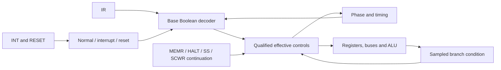

# Control logic study: from MOP tables to FPGA RTL

The current model can be expressed as a combinational control decoder plus
a small stateful controller and the datapath. A PLA is a useful way to
understand and inspect the Boolean functions. A future FPGA implementation
need not reproduce a physical two-level PLA: synthesis can map those
functions into the FPGA's lookup-table network. Yosys describes that FPGA
LUT mapping explicitly in its [ABC documentation](https://yosyshq.readthedocs.io/projects/yosys/en/latest/using_yosys/synthesis/abc.html).

This study provides an executable first export of the **base decoder**.
It is not yet a complete FPGA CPU or complete controller implementation.

## What the book actually describes

[Page46](../bookpages/Page_052.jpg) contrasts a microprogram ROM with shared
AND/OR logic. [Page47](../bookpages/Page_053.jpg) says CMC8 uses an
instruction decoder with five-input NAND gates and OR gates producing MOP
combinations. It then distinguishes phase gating near the PLA from timing
gates distributed near the datapath. [Figure4.8, p.48](../bookpages/Page_054.jpg)
shows the instruction/phase/timing decomposition.

Thus the source supports shared decoded functions followed by timing
qualification; it does not give a complete original PLA fuse map. Our
inferred MOP schedules can describe equivalent Boolean behavior without
recovering that historical transistor network or gate placement.

## Concrete export

```sh
python3 -m tools.build_control_pla
python3 -m unittest tests.test_control_pla
```

[The generator](../tools/build_control_pla.py) exports:

- [Authored-model-derived product terms](../specification/control-pla.json),
  with input/output definitions and size statistics.
- [VHDL-2008](../rtl/study/cmc8_control_pla.vhd).
- [Verilog](../rtl/study/cmc8_control_pla.v).

Each product term says “when these input bits have this pattern, assert
these outputs.” Input bits omitted by the mask are irrelevant to that term.
Several product terms can assert the same output; their results are ORed.
For example, one shared term is:

```text
normal mode AND F0 AND T3 → MOP7, MOP10, MOP12
```

It applies regardless of IR: all ordinary fetches compute PC+1 through the
same ALU/BR path. Other broader or narrower terms supply register selection
and the memory enable. This is the shared structure that made a PLA useful
in the original processor.

The input key is fifteen bits:

```text
mode[1:0] | IR[7:0] | phase[1:0] | timing[2:0]
```

Mode0 is ordinary instruction decoding, mode1 interrupt entry and mode2
reset. Mode3 is reserved. The controller must select a mode; the decoder
does not decide interrupt/reset priority itself.

The output vector has 63 bits:

| Bits | Meaning |
| --- | --- |
| 0…56 | MOP1…MOP57; unused numbers remain zero |
| 57 | STRCS |
| 58 | DCR's selected DI zero-test source |
| 59 | EXR's selected ALU input-A latch capture |
| 60 | EXR's selected held ALU input-A source |
| 61 | Reset's named INTA clear |
| 62 | This input combination has a defined base table entry |

That final flag means **defined in this exported table**, not “reachable
CPU state” or “valid opcode in every phase.” Early F0 fetch controls do not
need to decode the old IR, while F0T6/F0T7 do. Unused rows retained by the
selected schedules can be table-defined without being reached by normal
phase sequencing. F3 wait behavior is provided by the controller, not this
base decoder. The wait controller must also issue T7 RESET sampling while
F3 is active, even though that base row is undefined. Reserved/undefined export rows return zero with DEFINED=0;
this is an export policy, not a claim about undefined silicon behavior.

The export includes the current text interpretation and E001/E002/E003
corrections. It also includes deferred flag effects at F0T2, normal-fetch
MOP28, T7 MOP47, the H022 read-check overlay, and the explicitly named
EXR/DCR/INTA controls. Reset and interrupt modes suppress ordinary IR-based
controls. The research assumptions are therefore still visible in the HDL;
generating RTL does not turn them into documented hardware facts.

## Results and limits of the minimization

The current export has:

| Property | Result |
| --- | ---: |
| Binary input combinations checked | 32,768 |
| Defined base combinations | 9,822 |
| Shared AND/product terms | 335 |
| Input-literal connections | 3,130 |
| Product-to-output OR connections | 426 |

For each output, the generator merges exact Boolean implicants, chooses a
deterministic greedy cover, then shares identical products between outputs.
It never treats undefined combinations as don't-cares. This is a compact,
inspectable solution, **not a proof of minimum PLA size**.

All 32,768 binary combinations of the exported AND/OR equations agree with
the selected truth function. A separate test compares all 9,822 defined
rows with v018's existing sequencer under quiet inputs and an untaken branch
condition. This checks the export against the implementation rather than
only checking the minimizer against itself.

335 is **not an FPGA LUT count**. LUT area and timing require mapping and
placement on a selected device. The dense fifteen-bit-address table would
contain32,768×63=2,064,384 bits, but that deliberately includes modes,
register-encoded variants and unused combinations. It must not be compared
directly with the book's 43×24×50=51,600-bit family-level ROM estimate as if
they represented the same organization. A compact family/table design is
another option, and many outputs/combinations are constant or shared.

## The controller still needed around it



The base equations alone do not implement:

- Conditional MOP22/PG writes from H.Q-bar and opcode branch family.
- Suppression of interrupted T4 actions and retention of memory enables
  throughout F3, followed by execution of the original T4 once.
- HALT.Q, SSE and the single-step grant through a memory wait.
- Phase skipping at F1T1 without restarting the timing count.
- Asynchronous INTR capture, the HALT clear path, accepted-entry ordering
  and reset selection at T7.
- Storage captures, IR transparency endpoints or external DB direction.

Those are explicit controller/datapath responsibilities in v018. A full RTL
implementation must preserve them, including simultaneous old-value/new-value
rules for Link, INTA and PC selection. In particular, a simple ROM indexed
only by an instruction-local micro-PC would hide the retained-IR fetch tail
and the documented mid-phase wait/skip behavior unless designed carefully.

## FPGA implementation direction

The first full RTL version should retain three readable parts: the datapath,
the combinational control description, and the phase/wait/mode controller.
Express the control behavior clearly in VHDL or Verilog and let synthesis
optimize common logic. The generated AND/OR version is one measurable
baseline; a table/case version can later be compared under the same
truth-table tests and on the same FPGA.

A registered block-ROM implementation introduces a control-read clocking
requirement. AMD's [ROM guidance](https://docs.amd.com/r/en-US/ug901-vivado-synthesis/ROM-HDL-Coding-Techniques)
specifically describes properly registered ROM for block-RAM mapping.
Consequently a block-ROM controller needs an explicit schedule for when
control words are available; it cannot silently add a subdivision of latency
to the external signaling model. A faster internal FPGA clock with explicit
subdivision enables is a possible design approach, to be verified against
the Python endpoint model rather than assumed equivalent.

No target FPGA, synthesis tool or resource budget has been selected.
Yosys, GHDL, Icarus Verilog and Verilator are absent from this environment,
so the HDL is **generated but not compiled or synthesized**. Binary equation
and Python-sequencer equivalence are established; HDL simulation, mapping,
timing and hardware verification remain distinct next steps. Asynchronous
input handling and any synchronization choices must likewise be checked
against the intended processor behavior.

Validation for this pass: **343 tests pass** across the full suite. The
46 generated instruction-reference artifacts are current. Numbered CPU
models remain unchanged.
