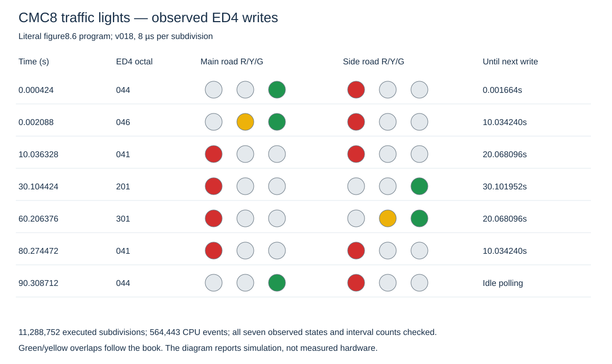

# Board harness and the traffic-light example

The first board fixture runs the complete traffic-light program from
figures8.3/8.6 on **unchanged v018**, including its MOP sequencing, TEST
branches, JSR/RSR, arithmetic flags, program-memory data reads and external
port writes. It forms a foundation for richer Midahs-style peripherals.

```sh
python3 -m cmc8.boards.traffic --delay-count 1
python3 -m cmc8.boards.traffic --sensor 3 --delay-count 1
python3 -m cmc8.boards.traffic --output /tmp/traffic-literal.json
python3 -m unittest tests.test_board_harness
```

The first two commands explicitly replace the delay-count operand with one
for a short validation run. The third preserves every source byte and runs
the full, approximately 90-second light cycle in **simulated time**. Host
execution takes longer because every subdivision goes through the research
simulator. No delay loop or CPU instruction is skipped.

## Source transcription and fixture

The [machine-code transcription](../specification/traffic-program.json)
preserves all 75 bytes, addresses000…112 octal, from
[p.146](../bookpages/Page_152.jpg) and
[p.147](../bookpages/Page_153.jpg). The
[assembly companion](../examples/traffic.asm) makes the control flow readable;
it is also accepted by the [standalone C assembler](../assembler/README.md).
The board fixture still loads the independent JSON transcription, so the
assembled bytes can be compared against a separate source.
[Figure8.3, p.141](../bookpages/Page_147.jpg) independently supplies the
lamp bit assignments and pattern codes.

The program starts at page0, byte000 after a reset cycle. The fixture states
that reset has already been sampled low at the preceding T7 and is now
released, matching the v017/v018 startup API. It explicitly initializes
INTE/INTR to zero and supplies a quiet INT; these are board experiment
initial conditions, not additional CPU reset effects. TEST pins start at
known zero levels, and a demand on T1 or T3 is driven high. That stimulus
does not assert anything about the original TEST pin bias.

The harness allows startup and several no-demand polling loops, asserts
one side-road demand, waits until the branch accepts it, then drops the
input. It runs the complete light sequence and verifies that idle polling
resumes afterward. Program page0 is read-only.

The port writes must be:

| Step | ED4 octal | Main road | Side road | Nominal following interval |
| --- | --- | --- | --- | --- |
| Startup/normal | 044 | Green | Red | Until demand |
| 1 | 046 | Green + yellow | Red | 10s |
| 2 | 041 | Red | Red | 20s |
| 3 | 201 | Red | Green | 30s |
| 4 | 301 | Red | Green + yellow | 20s |
| 5 | 041 | Red | Red | 10s |
| Normal restored | 044 | Green | Red | Poll again |

The simultaneous green/yellow lamps are the book's illustrative patterns;
the fixture preserves them. Neither road has green while the other road
has green. The two unused ED4 bits are not reassigned to lamps.

## Time calculation and source discrepancies

[Page144](../bookpages/Page_150.jpg) gives the Midahs clock as 62.5kHz:
one subdivision is 8 microseconds and one eight-subdivision machine cycle
is 64 microseconds. Those integer durations drive the board clock; wall time
never determines program behavior.

The delay routine initializes R3/R4 with two two-cycle LRI instructions.
Each of 122 outer iterations executes 256 copies of INR plus BZ0, followed
by DCR plus BZ0. RSR costs two cycles. Therefore its exact selected-model
cycle count is:

```text
4 + 122 × (256 × (3+2) + (3+2)) + 2 = 156,776 machine cycles
156,776 × 64µs = 10.033664s
```

A JSR adds three cycles, and each change of lamp pattern requires LRM/SRD.
Measured lamp intervals should therefore be slightly longer than the rounded
10/20/30/20/10-second diagram.

Two source comments appear mistaken; the machine-code bytes remain intact:

- Figure8.6 at octal103 prints `#172 (dec76)`. Octal172 is decimal122,
  agreeing with the p.144 timing calculation. The count is not changed to 76.
- The p.146 comment says T1 or T2, but its instructions explicitly select
  T1 and T3, matching the surrounding specification. The test stimulus uses
  T1/T3. These are candidate errata, not new accepted project corrections.

`--delay-count 1` makes the selected routine 1291 cycles instead, and the
complete shortened run has 93,832 subdivisions for the default T1 stimulus.
That is an explicit test-fixture patch at octal103, not a faster clock or a
pretended run of the literal source.

## External harness design

[BoardHarness](../cmc8/boards/harness.py) contains integer virtual time,
named byte ports, committed write events and bounded CPU trace history.
[Traffic](../cmc8/boards/traffic.py) supplies the book-specific program,
sensors and lamp decoding. Neither layer assigns instruction semantics or
writes CPU registers to accelerate ordinary execution.

`PortMemory` uses the existing external memory interface. Input reads are
pure observations of a port value; CPU writes are checked by the normal
MOP path. Peripheral state and write events change only after a successful
CPU slot. Rejected writes to a read-only input port therefore leave no
peripheral side effect. Unknown input data remains unknown.

Every port event records its subdivision and integer nanosecond timestamp
at the WRITE-falling slot. Output lamp state is derived from committed ED4
values, not inferred from which instruction the program was expected to run.

A full literal run executes millions of subdivisions. The harness retains
only the requested tail of CPU traces while keeping absolute slot counts
and the small port-event history. This bounds observation memory without
changing CPU progress. All peripheral-aware execution goes through
`board.step()`, `board.run_event()` or `board.run_until()`; bypassing them
with the CPU runner would bypass the peripheral observer.

The byte-port abstraction also hosts the separately documented
[Midahs-style front panel](midahs-panel.md), including keyboard input,
read/write display registers, switches and lamps. That fixture runs short
book examples and the corrected keyboard-polling subroutine; complete KEX
monitor hardware and software remain a distinct integration task.

## Validation

Six new tests check bus-level input/output, exact write timestamps,
read-only/unknown input behavior, source immutability, both demand sensors,
the entire shortened light sequence, bounded traces and the delay routine's
cycle count. Lamp intervals are compared with independent arithmetic,
including all nine JSR calls and instruction overhead. The unchanged full
source has also completed the longer integration experiment: 11,288,752
subdivisions and 564,443 CPU events, ending in normal polling with ED4=044.
The [recorded result](../specification/traffic-validation.json) and
[observed lamp diagram](figures/traffic-validation.svg) preserve the output
timeline. Exact interval and total counts are independently checked by
`python3 -m tools.render_traffic_report specification/traffic-validation.json /tmp/traffic.svg`.
The first serviced state occurs at0.002088s and normal lamps return at
90.308712s; that serviced interval is90.306624s including instruction overhead.

The port fixture uses named logical signals; it does not assume the tentative
PIN001 package assignment. The traffic program exercises its own instruction
subset, including the Z/branch delay loops; it supplies no new evidence for
EXR's latch or every other instruction family.



Validation for this pass: **343 tests pass** across the full suite. The
46 generated instruction-reference artifacts are current. Numbered CPU
models remain unchanged.
