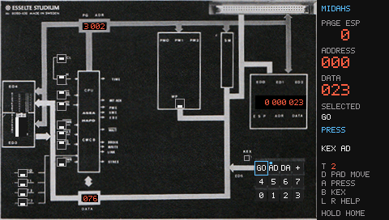
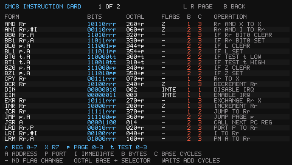

# Midahs — X7 photographic panel

A native **480×272** X7 app with the corrected panel photograph, live display/
lamp/switch/key overlays, and a readable sidebar. The CMC8 instruction emulator
executes the same reconstructed KEX monitor and preloaded SWITCHES program as
[the browser demo](../demos/midahs/README.md). Keys really reach the monitor;
software performs the memory edits and updates the displays.



## Build and install

The separate X7 SDK is expected at `../x7_app_sdk/`. It is unchanged. Required
build tools are CMake 3.20+, Python 3 and GCC/binutils `mips-linux-gnu`.
Use `-DX7_SDK=/path/to/sdk` if the SDK is elsewhere.

```sh
cmake -S x7_midahs -B x7_midahs/build
cmake --build x7_midahs/build -j
```

Copy the **contents of `x7_midahs/build/card/`** to the card root, preserving
other apps and settings. Card Launcher will show **Midahs**. The package contains:

```text
apps/midahs.app
apps/midahs.desktop
res/midahs/panel.rgb565
```

The photo is loaded from the absolute resource path, independent of the launcher
working directory. Missing/invalid artwork leaves a functional fallback panel.
No monitor/ROM download, Python runtime or image decoder is required on the
console. There is no on-console program-file loader in this first version.

## Controls

| Control | Action |
| --- | --- |
| D-pad | Move the snapping outline/pointer between switches, keypad and KEX |
| A | Toggle a selected switch; press/hold/release the selected keypad key; activate KEX |
| L / R | Open instruction reference; page backward/forward while it is open |
| B | KEX shortcut: return to the monitor, retaining user RAM, switches and lamps |
| Start | Pause/resume CPU execution |
| Select | Restore the initial SWITCHES program and reset the board |
| Volume | Shared system volume/overlay, even while paused; app itself is silent |
| Hold Home for 0.5s | Exit to Card Launcher |

Holding a direction repeats navigation after 0.3s, then every 0.1s. The selected
control is named in the sidebar. A physically held keypad key locks selection
until A release. In slow/manual mode a pending KEX key is retained until ED5 is
read; after releasing A you can navigate to CL and clock it through.
The monitor acts on release, like the book; even a quick A tap is held for at
least two host ticks so it cannot disappear between CPU work batches. If paused,
a key remains pending until the CPU resumes or is manually clocked. Select restores RAM; B/KEX preserves
it. KEX resumes the CPU if paused or stopped on a program error.

## Instruction reference card

Either shoulder button opens a full-screen, two-page alphabetical card. L/R
(or the D-pad) switch pages. B returns to the panel; A, Start and Select also
close the card without operating their usual panel actions. Help freezes the
machine and virtual clock, preserving the debugger pause state. Volume and
Home exit still work. Opening help releases any held keypad input.



Each row has the mnemonic/operand form, eight-bit pattern with `rrr`, `pp` or
`tt` selectors, octal base plus selector, changed flags, bytes, base cycles and
a short operation description. `r` is register 0–7, `p` page 0–3, `t` TEST 0–3,
`A` address byte, `P` I/O port and `I` immediate. X is R7. `-` means no flag
change. Cycle counts exclude external waits.

All **43 instruction families / 239 valid opcode encodings** are implemented.
This includes SCW with the SCWR switch, flag instructions and functional
interrupt/control handling. The 17 unassigned bytes fault. Board timing remains
an instruction-level approximation, not the MOP-edge model. The reference is
generated from the authored instruction catalogue; normal builds use its
committed header and need no research files.

## Additional panel controls

Select a control with the D-pad and press A to toggle it; the sidebar shows its
name, logical level or mode. Defaults are chosen to run KEX normally.

| Control | Effect |
| --- | --- |
| TT0–TT3 | Toggle the corresponding TEST input for BT0/BT1 |
| CLOCK | Cycle HIGH → MANUAL → LOW → HIGH |
| CL PULSE | In MANUAL mode, advance one virtual T subdivision; the sidebar shows T0–T7 |
| RESET | Low holds reset; high releases it, starting at program page 0, address 000 |
| INT | Active-low request; latches only when interrupts are enabled by EIN |
| MEMR | High stalls memory execution; low means ready |
| HALT | Low stops instruction execution; high runs |
| SS | With HALT low, high rearms and a transition to low grants one instruction |
| SCWR | High holds an SCW acknowledgement wait; low acknowledges it |
| WP | Prevent program-memory writes; storage memory and I/O remain writable |

HIGH uses the original clock. LOW is deliberately slow: eight virtual T pulses
per second, or one machine cycle per second. Its exact frequency is a demo
choice. In MANUAL, no automatic clock pulses occur. CL works even when debugger
pause is set. Instruction effects commit after the required number of pulses,
not at individual physical MOP edges; [model notes](docs/MODEL.md) explain this
instruction-level approximation. Wait loops and reset consume machine cycles.

HALT does not make SS a repeating run switch: return SS high then low for each
new instruction. A pending step survives MEMR waiting. SCWR affects SCW only;
KEX uses SCS, so changing SCWR alone will not stop the default monitor. An
interrupt enters at address 002 on the current page using the next PC register;
provide handler code before enabling interrupts. The default monitor/SWITCHES
program does not enable interrupts.

**Keep WP off when editing or using GO:** GO must write its page-2 jump stub.
Blocked writes leave memory unchanged and show WRITE BLOCKED. The entered data
may remain in the data display until you examine memory again. KEX preserves
physical switch settings; it cannot override held RESET or other blocking pins.
Select restores the default program and all controls to safe running states.

## First experiment

1. The pointer starts on GO. The sidebar shows page 0, address 000, data 023.
2. Tap A to run SWITCHES.
3. Press Left to select KEX, then continue Left across the board controls to
   reach the ED3 switches. Use Up/Down to choose a bit, and A to toggle it. The ED4 lamps on the left follow ED3.
4. B returns to KEX. RAM and output lamps survive; the monitor shows address 000.
5. Navigate back to the keypad and use + to examine successive bytes.

The sidebar enlarges page/address/data and shows KEX AD/DA, USER or PAUSED.
The tiny photographic labels are contextual artwork, not the only way to read
the controls. Crisp key legends and live digits are redrawn over the photograph.
The eight left switch targets are only three pixels apart; the sidebar names
the selected bit and enlarges its ON/OFF state. All 34 controls are reachable.

KEX address/data entry follows the browser reconstruction: AD accepts page plus
three octal address digits; DA accepts three octal data digits, writing on each
release. + increments the eight-bit offset without page carry. Two consecutive
ADs cycle program/storage/I/O examination. GO executes program memory through
the reserved page-2 stub at 316/317 octal. Page 3 is read-only monitor ROM.

[Model and artwork notes](docs/MODEL.md) distinguish the reconstructed monitor,
functional memory remapping and derived bus observations from original hardware.
[Testing](docs/TESTING.md) gives native checks, optional v018 comparisons and a
console smoke test. Host checks and the MIPS build pass; this app still needs
its own physical-console legibility/input check.
