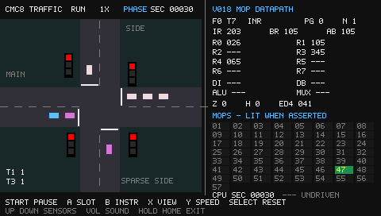

# CMC8 MOP traffic — X7 handheld

A native **480×272** X7 application running the book's unchanged traffic program
through a C port of the **v018 MOP tables and datapath**. This is not the browser
instruction interpreter. Every T subdivision, PC increment, ALU operation,
branch capture and ED4 write runs through the active micro-operations.

The left half shows cars and lights. The right half shows the executed F/T
slot, instruction, PG/N, eight registers, IR/BR/AB, DI/DB/ALU/MUX, Z/H, ED4,
and a numbered MOP activity grid. Pause and step to inspect the transfers.
Values are octal except explicitly labeled time, phase and timing.



## Build and copy to the console

The SDK remains untouched in sibling `../x7_app_sdk/`. Required tools are CMake
3.20+, Python 3, a C compiler and the `mips-linux-gnu` GCC/binutils toolchain.
No downloaded libraries, Python packages, firmware files or book scans are needed.
Use `-DX7_SDK=/path/to/x7_app_sdk` if it is elsewhere.

```sh
cmake -S x7_traffic -B x7_traffic/build
cmake --build x7_traffic/build -j
```

Copy the **contents of `x7_traffic/build/card/`** to the SD card root:

- `apps/cmc8-traffic.app`
- `apps/cmc8-traffic.desktop`

Card Launcher lists **CMC8 MOP Traffic**. No launcher installation, firmware
change, shared-volume default or local example settings file is shipped.
The app uses the SDK's tested firmware interface; this build still needs an
on-console smoke test on the compatible X7 firmware family.

## Controls

| Button | Action |
| --- | --- |
| Start | Pause/resume |
| A | Pause and execute one T subdivision |
| B | Pause and finish the current instruction, or execute the next at a boundary |
| X | Toggle inspector updates: PHASE boundaries / INSTR boundaries (F0T0) |
| Y | Cycle requested speed: 1× → 4× → 16× → ½× → 1× |
| Select | Restart CPU, clock, vehicles and deterministic random sequence |
| Up / Down | Hold manual demand on T1 / T3 |
| Volume buttons | Shared system master volume and standard overlay, including while paused |
| Hold Home for 0.5s | Exit cleanly to Card Launcher |

At a boundary, B steps RESET just like any other eight-slot event. Automatic
traffic pauses with the CPU. Up/Down are sensor overrides, not light controls;
holding either can repeatedly service the side road, as in the original program.
The default 1× setting targets the original Midahs clock, not maximum host speed.
Y changes only CPU time executed per host tick. Every MOP still executes.
Traffic has a separate fixed-rate clock: car speeds and arrival intervals do not
change with Y. The left SEC counter is traffic time; CPU SEC under the processor
panel shows CPU time. Faster CPU requests can be limited by console performance;
no delay loop is skipped to catch up. Speed
changes also work while paused, but A/B still step exact slots/instructions.
Select restores the default 1× rate. X changes only inspector snapshots:
PHASE includes the F1T1→F2T2 phase skip; INSTR captures the completed instruction
when the cursor returns to F0T0. The screen presents the latest snapshot at up
to 30 Hz, rather than drawing thousands of frames per second. Manual A stepping
always shows the exact stepped slot, in either mode. The traffic scene stays live
when running. The app is silent. Volume remains reserved for the shared system control rather
than being reassigned to simulator actions.

## Traffic demand

The original program has no minimum main-road green time. To avoid continual
side-road service, each side approach gets one car every **240–360 traffic
seconds**: five minutes per approach on average, or one car every 150 seconds
across both approaches. The initial arrivals at 12 and 26 seconds demonstrate
the first service together, then the sparse schedule takes over.

Main-road intervals are 3–12 traffic seconds per approach. Cars travel at
14–26 pixels per traffic second, twice the previous range. These speeds and
arrival rates stay fixed across CPU multiplier settings. Cars have
simple queue spacing; they stop for red or yellow, including green plus yellow,
and clear the crossing once past the stop point. Sensors detect vehicles near
the side-road stop lines. This is an illustrative straight-through traffic
scene, not a traffic engineering model. The vehicle pool is bounded at 32; a
full entrance/pool suppresses the next attempted arrival rather than overflowing.

## Validation and research boundary

The MIPS cross-build passes the SDK's ELF checks, including the O32 entry,
load window, two LOAD segments, BSS and 289 trap encodings. Native production
logic tests pass with ASan/UBSan. See [validation and smoke test](docs/TESTING.md).

The selected core implements the traffic program's instruction families, plus
the shared fetch and RESET sequences; it is not a general-purpose v018 port.
Unsupported opcodes, unknown values used for captures, and invalid ED writes
stop with a visible CPU fault. This first app has a built-in literal program,
not an on-console HEX loader.

[Implementation notes](docs/MODEL.md) explain the port, inherited assumptions,
clocking and inspector observations. The Python models and browser demos are
unchanged. The app can be built from this directory plus the SDK; only optional
research checks/regeneration need the rest of the repository.
